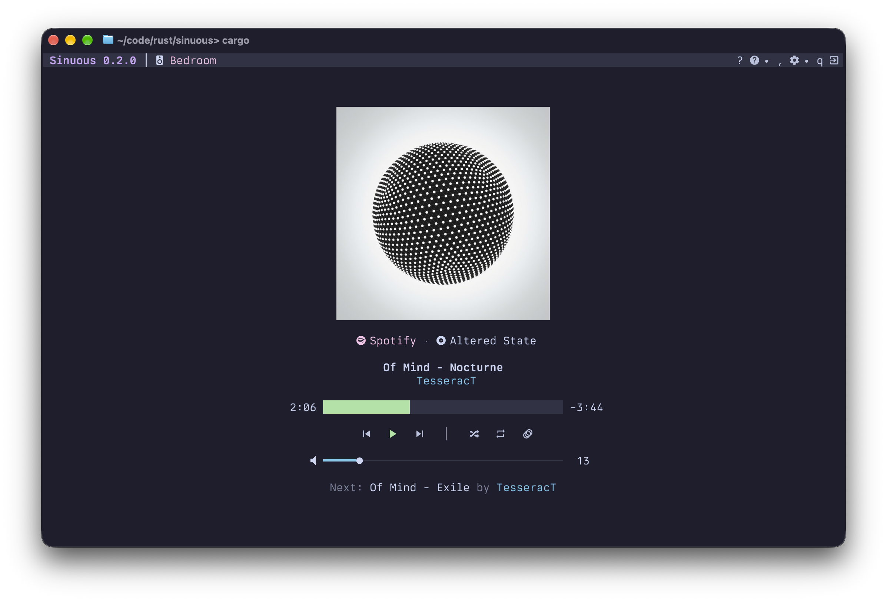

# Sinuous

[](https://deps.rs/repo/github/abusch/sinuous)
[](https://github.com/abusch/sinuous/actions/workflows/rust.yml)

Sinuous is a simple TUI for controlling local Sonos speakers.

It currently allows you to switch between the different groups (zone players)
from a panel showing what each of them is playing, displays the current and next
tracks with their album art, and lets you play your Sonos favorites.

Album art is drawn with the Kitty, iTerm2 or Sixel graphics protocols in
terminals that support one of them, and with coloured blocks otherwise.

Note: `sinuous` directly talks to the Sonos speakers via their local websocket
API (using [sinuous-client](https://github.com/abusch/sinuous-client)), and the
speakers are discovered via the SSDP protocol. This means your Sonos speakers
need to be on the same network (or visible from your current network).

## Key bindings

- <kbd>Space</kbd>: Play / Pause
- <kbd>p</kbd> / <kbd>n</kbd>: Skip to previous / next track
- <kbd>s</kbd> / <kbd>r</kbd> / <kbd>c</kbd>: Toggle shuffle / repeat (all, one, off) / crossfade
- <kbd>[</kbd> / <kbd>]</kbd>: Adjust volume of the current group
- <kbd>v</kbd>: Adjust the volume of the current group or of each of its speakers
- <kbd>g</kbd>: Switch to another group, from a panel showing what each group is playing
- <kbd>G</kbd>: Add speakers to / remove speakers from the current group, from a
  panel showing which group each speaker is in
- <kbd>f</kbd>: Play one of your Sonos favorites
- <kbd>,</kbd>: Change the settings
- <kbd>?</kbd>: Show the keyboard shortcuts
- <kbd>q</kbd>: Close what is open, or quit

## To run

Install a recent Rust toolchain via [rustup](https://rustup.rs), if you don't
already have one, then simply run `cargo run`.

To get debug logs, run `RUST_LOG="sinuous=debug" cargo run`. The logs can be
found in `/tmp/sinuous.log`.

## Configuration

Sinuous reads its settings from `~/.config/sinuous/config.toml` (or
`$XDG_CONFIG_HOME/sinuous/config.toml`, or `%APPDATA%\sinuous\config.toml` on
Windows), if it exists. Use `--config <path>` to read another file instead.
All settings are optional. The `[ui]` settings can also be changed while
running by pressing <kbd>,</kbd>, which saves them to the file:

```toml
[core]
# The speakers to connect to, as IPv4 addresses or names. Speakers are
# discovered via SSDP if not set. `--device` overrides this.
devices = ["192.168.1.10", "Living Room"]

[ui]
# Whether to show the album art of the current track.
album_art = true
# Whether to show icons instead of labels for actions, play modes and kinds of
# sources, and before the names of music services. Requires a Nerd Font
# (https://www.nerdfonts.com).
nerd_font = false
# The colours to use: "terminal" for the terminal's own, or one of the themes of
# opaline (https://github.com/hyperb1iss/opaline#-builtin-themes): ayu-dark,
# ayu-light, ayu-mirage, catppuccin-frappe, catppuccin-latte,
# catppuccin-macchiato, catppuccin-mocha, dracula, everforest-dark,
# everforest-light, flexoki-dark, flexoki-light, github-dark-dimmed,
# github-light, gruvbox-dark, gruvbox-light, kanagawa-dragon, kanagawa-lotus,
# kanagawa-wave, light-owl, monokai-pro, night-owl, nord, one-dark, one-light,
# palenight, rose-pine, rose-pine-dawn, rose-pine-moon, silkcircuit-dawn,
# silkcircuit-glow, silkcircuit-neon, silkcircuit-soft, silkcircuit-vibrant,
# solarized-dark, solarized-light, tokyo-night, tokyo-night-moon,
# tokyo-night-storm.
theme = "terminal"
```

## Screenshot



## Todo

- [x] Allow switching between speakers
- [ ] Support more actions (seek forward, backward, change playing mode, volume...)
- [x] Display play/pause indicator as well as current play mode (shuffle+repeat)
- [ ] Allow searching for tracks and modify the queue
- [x] Allow customizing colours
- [x] Allow specifying speaker to connect to as a command line argument
- [x] Handle grouping of speakers
